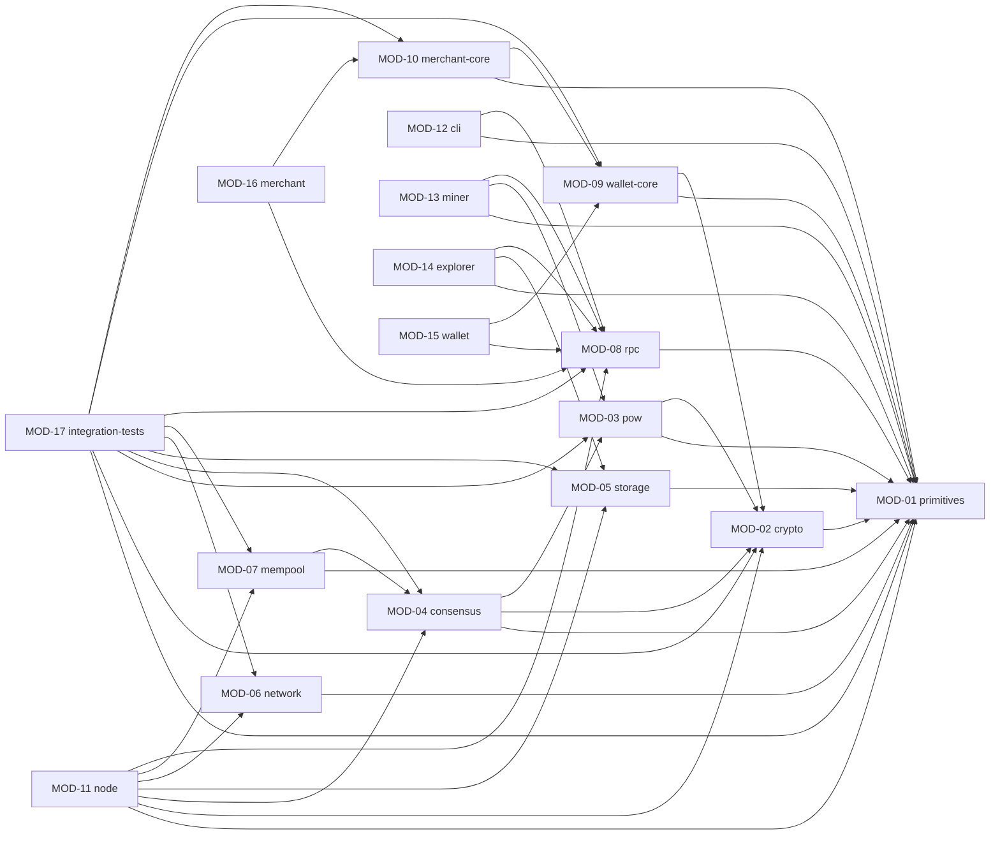

# Peta Sistem Homeostasis Coin (HSIS)

## Daftar Modul

Legenda: 🟢 selesai · 🟡 berjalan · 🔴 terblokir · ⚪ belum dimulai · ❓ perlu keputusan

| ID | Path | Paket | Fungsi | Bergantung pada | Status |
|---|---|---|---|---|---|
| MOD-01 | `crates/primitives` | `homeostasis-primitives` | Tipe dasar: jumlah (u128 quanta), tinggi blok, hash, parameter chain, struktur blok dan transaksi | — | ⚪ |
| MOD-02 | `crates/crypto` | `homeostasis-crypto` | BLAKE3, Schnorr BIP340, MuSig2 | MOD-01 | ⚪ |
| MOD-03 | `crates/pow` | `homeostasis-pow` | Proof of Work: antarmuka dan PoW dev regtest (DEC-09); PoW mainnet menunggu DEC-01 | MOD-01, 02 (DEC-14) | ⚪ |
| MOD-04 | `crates/consensus` | `homeostasis-consensus` | Satu-satunya tempat aturan konsensus: pasokan, validasi, ASERT, cap waktu | MOD-01, 02, 03 | ⚪ |
| MOD-05 | `crates/storage` | `homeostasis-storage` | Penyimpanan blok, set UTXO, pruning | MOD-01 | ⚪ |
| MOD-06 | `crates/network` | `homeostasis-network` | P2P (rust-libp2p) | MOD-01 | ⚪ |
| MOD-07 | `crates/mempool` | `homeostasis-mempool` | Antrean transaksi | MOD-01, 04 | ⚪ |
| MOD-08 | `crates/rpc` | `homeostasis-rpc` | Tipe dan klien/server JSON-RPC | MOD-01 | ⚪ |
| MOD-09 | `crates/wallet-core` | `homeostasis-wallet-core` | Kunci, penyusunan dan penandatanganan transaksi | MOD-01, 02 | ⚪ |
| MOD-10 | `crates/merchant-core` | `homeostasis-merchant-core` | Tagihan watch-only, status pembayaran | MOD-01, 09 | ⚪ |
| MOD-11 | `apps/node` | `homeostasis-node` (bin) | Daemon node | MOD-01, 02, 04, 05, 06, 07, 08 (DEC-19) | 🟢 |
| MOD-12 | `apps/cli` | `homeostasis-cli` (bin) | Alat baris perintah ke node | MOD-01, 08 | ⚪ |
| MOD-13 | `apps/miner` | `homeostasis-miner` (bin) | Penambang CPU | MOD-01, 03, 08 | ⚪ |
| MOD-14 | `apps/explorer` | `homeostasis-explorer` (bin) | Indexer dan API explorer (web menyusul) | MOD-01, 05, 08 | ⚪ |
| MOD-15 | `apps/wallet` | (belum dibuat) | Wallet Tauri desktop dan mobile | MOD-08, 09 | ⚪ |
| MOD-16 | `apps/merchant` | (belum dibuat) | Aplikasi pelaku usaha, Tauri | MOD-08, 10 | ⚪ |
| MOD-17 | `tests/integration` | `homeostasis-integration-tests` | Uji integrasi lintas crate | semua crate inti | ⚪ |

## Diagram Dependensi Modul

Panah `A --> B` menunjukkan bahwa modul `A` bergantung pada modul `B` (sesuai kolom "Bergantung pada").

## Matriks fitur × modul

Keterangan: ● = memakai atau mengubah modul · ○ = hanya membaca

| Fitur ↓ / Modul → | 01 | 02 | 03 | 04 | 05 | 06 | 07 | 08 | 09 | 10 | 11 | 12 | 13 | 14 | 15 | 16 | 17 |
|---|---|---|---|---|---|---|---|---|---|---|---|---|---|---|---|---|---|
| FTR-01 Node regtest | ● | ● | ● | ● | ● | | | ● | | | ● | | | | | | ● |
| FTR-02 Menambang | ● | | ● | ● | ○ | | | ● | | | ● | | ● | | | | ● |
| FTR-03 Kirim dan terima | ● | ● | | ● | ○ | | ● | ● | ● | | ● | ● | | | | | ● |
| FTR-04 Multi-node | ○ | | | ● | ● | ● | ○ | | | | ● | | | | | | ● |
| FTR-05 Explorer | ○ | | | ○ | ● | | | ● | | | | | | ● | | | |
| FTR-06 Testnet publik | ● | ● | ● | ● | ● | ● | ● | ● | ● | | ● | ● | ● | ● | | | ● |
| FTR-07 Wallet desktop | ○ | | | | | | | ● | ● | | | | | | ● | | |
| FTR-08 Wallet mobile | ○ | | | | | | | ● | ● | | | | | | ● | | |
| FTR-09 Pelaku usaha | ○ | | | | | | | ● | ● | ● | | | | | | ● | |
| FTR-10 Rilis | | | | | | | | | | | ● | ● | ● | ● | ● | ● | |

**Analisis dampak:** MOD-04 (consensus) dipakai oleh FTR-01 sampai FTR-06; setiap perubahannya wajib diuji ulang lewat MOD-17.
