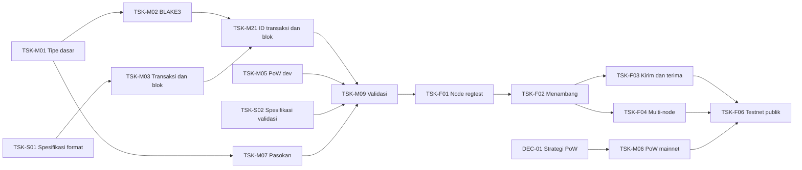

# Task kerja: TSK-S02 berikutnya, jalur kritis menuju node regtest (TSK-F01)

> Diperbarui: 29 Oktober 2026 · Status keseluruhan: 🟡

| Status | Ringkasan |
|---|---|
| 🟢 Selesai | TSK-M01 (tipe dasar), TSK-M02 (BLAKE3), TSK-M03 (encoding transaksi dan blok), TSK-M04 (Schnorr), TSK-M07 (rumus pasokan), TSK-M21 (ID transaksi dan blok), TSK-M05 (PoW dev regtest), TSK-M22 (OutPoint dan UtxoEntry), TSK-M10 (penyimpanan in-memory), TSK-M11 (penyimpanan redb), TSK-M24 (sighash v1) |
| 🟡 Siap dikerjakan | — (task modul berikutnya menunggu TSK-S02) |
| 🔴 Terblokir | TSK-M06 dan TSK-F06 oleh DEC-01 |
| ❓ Keputusan dibutuhkan | DEC-10 bagian 2 (async, P2P, RPC, logging) |
| ➡️ Langkah berikutnya | TSK-S02 (Quick) |

## Tiga jenis task

| Jenis | Prefix | Siapa | Aturan |
|---|---|---|---|
| **Modul** | TSK-M | Agent | Hanya menyentuh satu folder modul (satu crate atau satu aplikasi). Tidak mengubah modul lain |
| **Fitur** | TSK-F | Agent | Menyatukan beberapa modul menjadi kemampuan bagi pengguna. Baru boleh dimulai setelah semua task modul yang dibutuhkan 🟢 |
| **Spesifikasi** | TSK-S | Pencipta + Quick | Menetapkan aturan yang belum tertulis. Hasilnya dokumen di docs/reference/, bukan kode |

Kartu task yang siap dikerjakan disimpan sebagai file `TSK-xxx-*.md` di folder ini. Cara memberi task:
`Kerjakan docs/tasks/<file>. Gunakan mode Planning.`

## Backlog: task spesifikasi (TSK-S)

| ID | Judul | Memblokir | Status |
|---|---|---|---|
| TSK-S01 | Format transaksi UTXO dan blok, encoding kanonis, format alamat, sighash | TSK-M03 | 🟢 v0.1 lengkap di [reference/spesifikasi-format-v0.1.md](../reference/spesifikasi-format-v0.1.md), termasuk sighash (DEC-13) |
| TSK-S02 | Aturan validasi: coinbase, kematangan, biaya, ukuran, chainwork, rumus ASERT bilangan bulat, cap waktu | TSK-M08, TSK-M09 | ⚪ |
| TSK-S03 | Wallet: BIP39, jalur turunan kunci, alamat watch-only, filter blok | TSK-M15 | ⚪ |
| TSK-S04 | Pesan P2P dan daftar metode RPC final | TSK-M12, TSK-M14 | ⚪ |

## Backlog: task modul (TSK-M)

| ID | Modul | Judul | Bergantung pada | Status |
|---|---|---|---|---|
| TSK-M01 | MOD-01 | Tipe dasar: Amount, BlockHeight, Hash32, parameter chain | — | 🟢 selesai ([kartu](TSK-M01-primitives-tipe-dasar.md)) |
| TSK-M02 | MOD-02 | Hash BLAKE3 dengan pemisah domain dan Merkle root (crate blake3) | TSK-M01 | 🟢 selesai ([kartu](TSK-M02-crypto-blake3.md)) |
| TSK-M03 | MOD-01 | Struktur transaksi dan blok, encoding kanonis (tanpa hashing) | TSK-M01, TSK-S01 | 🟢 selesai ([kartu](TSK-M03-primitives-encoding.md)) |
| TSK-M04 | MOD-02 | Schnorr BIP340 (crate k256): kunci, tanda tangan, verifikasi, vektor uji resmi | TSK-M01 | 🟢 selesai ([kartu](TSK-M04-crypto-schnorr.md)) |
| TSK-M05 | MOD-03 | Antarmuka PoW dan PoW dev untuk regtest | TSK-M02, TSK-M03, DEC-14, DEC-15 | 🟢 selesai ([kartu](TSK-M05-pow-dev.md)) |
| TSK-M06 | MOD-03 | PoW mainnet | DEC-01 | 🔴 |
| TSK-M07 | MOD-04 | Rumus pasokan dan vektor uji | TSK-M01 | 🟢 selesai ([kartu](TSK-M07-consensus-pasokan.md)) |
| TSK-M08 | MOD-04 | Target compact ke `Target` 256-bit (DEC-15), ASERT, median waktu, chainwork | TSK-M01, TSK-M05, TSK-S02 | ⚪ |
| TSK-M09 | MOD-04 | Validasi transaksi dan blok, termasuk penolakan PoW dev di testnet dan mainnet beserta test-nya (DEC-09) | TSK-M03, M04, M05, M07, M08, M21, M24, TSK-S02 | ⚪ |
| TSK-M10 | MOD-05 | Penyimpanan in-memory: trait ChainStore, MemoryStore, set UTXO, undo data | TSK-M03, TSK-M22 | 🟢 selesai ([kartu](TSK-M10-storage-memory.md)) |
| TSK-M11 | MOD-05 | Penyimpanan persisten RedbStore (redb 4.4.0, DEC-03), uji diferensial terhadap MemoryStore | TSK-M10 | 🟢 selesai ([kartu](TSK-M11-storage-redb.md)) |
| TSK-M12 | MOD-08 | Tipe dan server/klien JSON-RPC | TSK-M03, TSK-S04, DEC-10 | ⚪ |
| TSK-M13 | MOD-07 | Mempool | TSK-M09 | ⚪ |
| TSK-M14 | MOD-06 | P2P dasar (rust-libp2p) | TSK-M03, TSK-S04, DEC-10 | ⚪ |
| TSK-M15 | MOD-09 | BIP39 dan turunan kunci | TSK-M04, TSK-S03 | ⚪ |
| TSK-M16 | MOD-09 | Penyusunan dan penandatanganan transaksi, pemilihan koin | TSK-M03, TSK-M15, TSK-M24 | ⚪ |
| TSK-M17 | MOD-10 | Tagihan watch-only dan status pembayaran | TSK-M16 | ⚪ |
| TSK-M18 | MOD-11 | Node: konfigurasi, folder data, logging, shutdown | DEC-10 | ⚪ |
| TSK-M19 | MOD-12 | CLI: perintah dan klien RPC | TSK-M12 | ⚪ |
| TSK-M20 | MOD-13 | Miner: loop penambangan dengan PoW dev | TSK-M05, TSK-M12 | ⚪ |
| TSK-M21 | MOD-02 | ID transaksi dan blok: txid, wtxid, block_id, hash kondisi, Merkle root blok | TSK-M02, TSK-M03 | 🟢 selesai ([kartu](TSK-M21-crypto-ids.md)) |
| TSK-M22 | MOD-01 | Tipe OutPoint dan UtxoEntry (dipakai bersama MOD-04, MOD-05, MOD-07, MOD-09) | TSK-M03 | 🟢 selesai ([kartu](TSK-M22-primitives-utxo.md)) |
| TSK-M23 | MOD-05 | Pruning badan blok lama (undo data tetap disimpan), termasuk perilaku undo_tip untuk blok yang badannya sudah dibuang | TSK-M11 | ⚪ |
| TSK-M24 | MOD-02 | Pesan tanda tangan sighash v1 (DEC-13) | TSK-M21 | 🟢 selesai ([kartu](TSK-M24-crypto-sighash.md)) |

## Backlog: task fitur (TSK-F)

| ID | Fitur | Bergantung pada | Status |
|---|---|---|---|
| TSK-F01 | FTR-01 Node regtest tunggal | TSK-M09, M10, M12, M18 | ⚪ |
| TSK-F02 | FTR-02 Menambang di regtest | TSK-F01, TSK-M20 | ⚪ |
| TSK-F03 | FTR-03 Kirim dan terima lewat CLI | TSK-F02, TSK-M13, M16, M19 | ⚪ |
| TSK-F04 | FTR-04 Jaringan multi-node dan uji reorg | TSK-F02, TSK-M14 | ⚪ |
| TSK-F05 | FTR-05 Explorer minimal | TSK-F01, TSK-M11 | ⚪ |
| TSK-F06 | FTR-06 Testnet publik | TSK-F03, F04, F05, TSK-M06 | 🔴 DEC-01 |
| TSK-F07 | FTR-07 Wallet desktop | TSK-F03, DEC-04 | ⚪ dipecah nanti |
| TSK-F08 | FTR-08 Wallet mobile | TSK-F07, DEC-04, DEC-05 | ⚪ dipecah nanti |
| TSK-F09 | FTR-09 Aplikasi pelaku usaha | TSK-M17, TSK-F07, DEC-06 | ⚪ dipecah nanti |
| TSK-F10 | FTR-10 Reproducible build dan rilis | TSK-F06, DEC-07 | ⚪ dipecah nanti |

## Jalur kritis menuju testnet

**Bisa dikerjakan paralel:** TSK-M07 bersamaan dengan TSK-S01; TSK-M02 dan TSK-M04 setelah TSK-M01; TSK-M10, M12, M14 setelah TSK-M03.

## Titik rawan
- 🟢 **TSK-S01** lengkap, termasuk sighash v1 (DEC-13, TSK-M24).
- 🔴 **DEC-01** satu-satunya yang menahan testnet publik. Jalur regtest tetap berjalan lewat PoW dev (DEC-09, disetujui).
- 🟡 **MOD-04 consensus** dipakai node, mempool, miner, dan semua fitur. Setiap perubahannya berdampak luas.

## Aturan pembaruan
Setiap task yang selesai wajib memperbarui status di tabel ini dan di kartu modul terkait sebagai bagian dari commit task itu.
