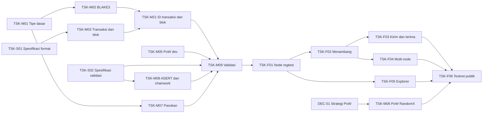

# Task kerja: FTR-01 sampai FTR-03 selesai, cabang chain dan reorg (TSK-M27) menuju FTR-04

> Diperbarui: 5 November 2026 · Status keseluruhan: 🟡

| Status | Ringkasan |
|---|---|
| 🟢 Selesai | TSK-S01, TSK-S02 (aturan validasi), TSK-S03 (wallet v0.1), TSK-S04 (RPC v0.1), TSK-S05 (P2P v0.1), TSK-S06 (explorer v0.1), TSK-S07 (antarmuka web explorer v0.2), TSK-M01, M02, M03, M04, M05, M07, M08, M09, M10, M11, M12, M13, M14, M15, M16, M18, M19, M27, M28, M29, M30, M31, M32, M33, M34, M35, M36, M37, M38, M39, M40, M20, M21, M22, M24, M25, M26, TSK-F01 (node regtest tunggal), TSK-F02 (menambang di regtest), TSK-F03 (kirim dan terima lewat CLI), TSK-F04 (jaringan multi-node dan reorg dalam), TSK-F05 (explorer minimal) |
| 🟡 Siap dikerjakan | TSK-M23 (pruning) |
| 🔴 Terblokir | TSK-F06 oleh TSK-M06 (bagian B dan C) dan parameter testnet |
| ❓ Keputusan dibutuhkan | — (DEC-01 diputuskan 5 November 2026) |
| ➡️ Langkah berikutnya | TSK-M06 bagian A selesai (pustaka RandomX di MOD-03, vektor resmi); bagian B (konsensus dan node) dan C (salt sendiri, penambang mode cepat, parameter testnet), lalu TSK-F06 testnet publik. DEC-02 lisensi (MIT OR Apache-2.0), TSK-M35, TSK-M33, dan TSK-M40 selesai |

## Tiga jenis task

| Jenis | Prefix | Siapa | Aturan |
|---|---|---|---|
| **Modul** | TSK-M | Agent | Hanya menyentuh satu folder modul (satu crate atau satu aplikasi). Tidak mengubah modul lain |
| **Fitur** | TSK-F | Agent | Menyatukan beberapa modul menjadi kemampuan bagi pengguna. Baru boleh dimulai setelah semua task modul yang dibutuhkan 🟢 |
| **Spesifikasi** | TSK-S | Pencipta + Quick | Menetapkan aturan yang belum tertulis. Hasilnya dokumen di docs/reference/, bukan kode |

Kartu task yang siap dikerjakan disimpan sebagai file `TSK-xxx-*.md` di folder ini. Cara memberi task:
`Kerjakan docs/tasks/<file>. Gunakan mode Planning.`

## Backlog: task spesifikasi (TSK-S)

| ID | Judul | Memblokir | Status |
|---|---|---|---|
| TSK-S01 | Format transaksi UTXO dan blok, encoding kanonis, format alamat, sighash | TSK-M03 | 🟢 v0.1 lengkap di [reference/spesifikasi-format-v0.1.md](../reference/spesifikasi-format-v0.1.md), termasuk sighash (DEC-13) |
| TSK-S02 | Aturan validasi: coinbase, kematangan, biaya, ukuran, chainwork, rumus ASERT bilangan bulat, cap waktu | TSK-M08, TSK-M09 | 🟢 v0.1 di [reference/spesifikasi-validasi-v0.1.md](../reference/spesifikasi-validasi-v0.1.md), termasuk DEC-17 |
| TSK-S03 | Wallet: BIP39, jalur turunan kunci, alamat watch-only, filter blok | TSK-M15 | 🟢 v0.1 di [reference/spesifikasi-wallet-v0.1.md](../reference/spesifikasi-wallet-v0.1.md) (DEC-21, DEC-22, DEC-10 bagian 4); filter blok ditunda |
| TSK-S04 | Daftar metode RPC dan aturan encoding JSON (regtest, FTR-01 sampai FTR-03) | TSK-M12 | 🟢 v0.1 di [reference/spesifikasi-rpc-v0.1.md](../reference/spesifikasi-rpc-v0.1.md) |
| TSK-S05 | Pesan P2P (sinkronisasi header dan blok, gossip transaksi) | TSK-M14 | 🟢 v0.1 di [reference/spesifikasi-p2p-v0.1.md](../reference/spesifikasi-p2p-v0.1.md) (DEC-24, DEC-10 bagian 5) |
| TSK-S06 | Explorer: indeks SQLite tahan reorg, pemeriksaan jumlah koin, API HTTP baca saja, halaman alokasi genesis | TSK-M29, TSK-M30 | 🟢 v0.1 di [reference/spesifikasi-explorer-v0.1.md](../reference/spesifikasi-explorer-v0.1.md) (DEC-25, DEC-10 bagian 6) |
| TSK-S07 | Antarmuka web explorer: halaman, dua bahasa, format jumlah `bigint`, keamanan, penyajian `--web-dir`, dependensi npm | TSK-M31, TSK-M32, TSK-M38 | 🟢 v0.2 di [reference/spesifikasi-explorer-web-v0.2.md](../reference/spesifikasi-explorer-web-v0.2.md) (DEC-26, DEC-10 bagian 7; v0.1 diganti) |

## Backlog: task modul (TSK-M)

| ID | Modul | Judul | Bergantung pada | Status |
|---|---|---|---|---|
| TSK-M01 | MOD-01 | Tipe dasar: Amount, BlockHeight, Hash32, parameter chain | — | 🟢 selesai ([kartu](TSK-M01-primitives-tipe-dasar.md)) |
| TSK-M02 | MOD-02 | Hash BLAKE3 dengan pemisah domain dan Merkle root (crate blake3) | TSK-M01 | 🟢 selesai ([kartu](TSK-M02-crypto-blake3.md)) |
| TSK-M03 | MOD-01 | Struktur transaksi dan blok, encoding kanonis (tanpa hashing) | TSK-M01, TSK-S01 | 🟢 selesai ([kartu](TSK-M03-primitives-encoding.md)) |
| TSK-M04 | MOD-02 | Schnorr BIP340 (crate k256): kunci, tanda tangan, verifikasi, vektor uji resmi | TSK-M01 | 🟢 selesai ([kartu](TSK-M04-crypto-schnorr.md)) |
| TSK-M05 | MOD-03 | Antarmuka PoW dan PoW dev untuk regtest | TSK-M02, TSK-M03, DEC-14, DEC-15 | 🟢 selesai ([kartu](TSK-M05-pow-dev.md)) |
| TSK-M06 | MOD-03 (bagian B dan C juga MOD-04, 11, 13) | PoW RandomX testnet dan mainnet | DEC-01 | 🟡 A, B, C1, C2, C3a selesai; C3b berjalan ([kartu](TSK-M06-pow-randomx.md)) |
| TSK-M07 | MOD-04 | Rumus pasokan dan vektor uji | TSK-M01 | 🟢 selesai ([kartu](TSK-M07-consensus-pasokan.md)) |
| TSK-M08 | MOD-04 | Target compact ke `Target` 256-bit (DEC-15), ASERT, median waktu, chainwork, parameter per jaringan, genesis regtest (Spesifikasi Validasi Bagian 2–6, 10) | TSK-M01, TSK-M05, TSK-M25, TSK-S02 | 🟢 selesai ([kartu](TSK-M08-consensus-target-asert.md)) |
| TSK-M09 | MOD-04 | Validasi transaksi dan blok (Spesifikasi Validasi Bagian 7–9), termasuk penolakan PoW dev di testnet dan mainnet beserta test-nya (DEC-09) | TSK-M03, M04, M05, M07, M08, M21, M24, TSK-S02 | 🟢 selesai ([kartu](TSK-M09-consensus-validasi.md)) |
| TSK-M10 | MOD-05 | Penyimpanan in-memory: trait ChainStore, MemoryStore, set UTXO, undo data | TSK-M03, TSK-M22 | 🟢 selesai ([kartu](TSK-M10-storage-memory.md)) |
| TSK-M11 | MOD-05 | Penyimpanan persisten RedbStore (redb 4.4.0, DEC-03), uji diferensial terhadap MemoryStore | TSK-M10 | 🟢 selesai ([kartu](TSK-M11-storage-redb.md)) |
| TSK-M12 | MOD-08 | Tipe dan server/klien JSON-RPC (Spesifikasi RPC v0.1) | TSK-M03, TSK-S04, DEC-10 | 🟢 selesai ([kartu](TSK-M12-rpc.md)) |
| TSK-M13 | MOD-07 | Mempool | TSK-M09, DEC-18 | 🟢 selesai ([kartu](TSK-M13-mempool.md)) |
| TSK-M14 | MOD-06 | P2P dasar: swarm libp2p 0.57, 5 protokol, codec, kunci rekan, sanksi (Spesifikasi P2P Bagian 1 sampai 7) | TSK-M03, TSK-S05, DEC-24 | 🟢 selesai ([kartu](TSK-M14-network-libp2p.md)) |
| TSK-M15 | MOD-09 (+ MOD-02) | BIP39, turunan BIP32, kunci akun publik, alamat bech32m | TSK-M04, TSK-S03, DEC-10 bagian 4 | 🟢 selesai ([kartu](TSK-M15-wallet-frasa-turunan-alamat.md)) |
| TSK-M16 | MOD-09 | Penyusunan dan penandatanganan transaksi, pemilihan koin | TSK-M03, TSK-M15, TSK-M24 | 🟢 selesai ([kartu](TSK-M16-wallet-kirim.md)) |
| TSK-M17 | MOD-10 | Tagihan watch-only dan status pembayaran | TSK-M16 | ⚪ |
| TSK-M18 | MOD-11 | Node: logika chain dan backend RPC (A), lalu konfigurasi, folder data, logging, shutdown (B) | TSK-M09, M11, M12, M13, M26, DEC-10, DEC-19 | 🟢 selesai ([kartu](TSK-M18-node.md)) |
| TSK-M19 | MOD-12 | CLI: perintah node dan wallet regtest | TSK-M12, TSK-M16, DEC-21 | 🟢 selesai ([kartu](TSK-M19-cli-wallet.md)) |
| TSK-M20 | MOD-13 | Miner: loop penambangan dengan PoW dev | TSK-M05, TSK-M12, TSK-M18 | 🟢 selesai ([kartu](TSK-M20-miner.md)) |
| TSK-M21 | MOD-02 | ID transaksi dan blok: txid, wtxid, block_id, hash kondisi, Merkle root blok | TSK-M02, TSK-M03 | 🟢 selesai ([kartu](TSK-M21-crypto-ids.md)) |
| TSK-M22 | MOD-01 | Tipe OutPoint dan UtxoEntry (dipakai bersama MOD-04, MOD-05, MOD-07, MOD-09) | TSK-M03 | 🟢 selesai ([kartu](TSK-M22-primitives-utxo.md)) |
| TSK-M23 | MOD-05 | Pruning badan blok lama (undo data tetap disimpan), termasuk perilaku undo_tip untuk blok yang badannya sudah dibuang | TSK-M11 | ⚪ |
| TSK-M24 | MOD-02 | Pesan tanda tangan sighash v1 (DEC-13) | TSK-M21 | 🟢 selesai ([kartu](TSK-M24-crypto-sighash.md)) |
| TSK-M26 | MOD-05 | Iterasi set UTXO berdasarkan payload untuk `scan_utxos` (Spesifikasi RPC 3.8), di MemoryStore dan RedbStore | TSK-M11, TSK-S04 | 🟢 selesai ([kartu](TSK-M26-storage-scan-utxo.md)) |
| TSK-M27 | MOD-11 | Blok cabang, pemilihan chain berdasarkan chainwork, reorg tanpa batas kedalaman (Spesifikasi P2P Bagian 5) | TSK-M11, TSK-M18, TSK-S05 | 🟢 selesai ([kartu](TSK-M27-cabang-reorg.md)) |
| TSK-M28 | MOD-11 | Indeks header, sinkronisasi header lalu blok, siaran blok dan transaksi, opsi `--p2p-port` dan `--connect` (Spesifikasi P2P Bagian 4 sampai 8) | TSK-M14, TSK-M27 | 🟢 selesai ([kartu](TSK-M28-p2p-daemon.md)) |
| TSK-M29 | MOD-14 | Indexer SQLite: skema, sinkronisasi lewat RPC, reorg tanpa batas, pemeriksaan I1–I4, query (Spesifikasi Explorer Bagian 2 sampai 4) | TSK-S06, DEC-25 | 🟢 selesai ([kartu](TSK-M29-explorer-indexer.md)) |
| TSK-M30 | MOD-14 | API HTTP axum `GET /api/v1/…`, program `homeostasis-explorer` (opsi, sinyal, stdout `http:`) (Spesifikasi Explorer Bagian 5 dan 6) | TSK-M29 | 🟢 selesai ([kartu](TSK-M30-explorer-api.md)) |
| TSK-M31 | MOD-14 | Opsi `--web-dir`, penyajian file web yang aman, kepala keamanan (Spesifikasi Explorer Web Bagian 7) | TSK-M30, TSK-S07 | 🟢 selesai ([kartu](TSK-M31-explorer-web-dir.md)) |
| TSK-M32 | MOD-14 (`web/`) | Aplikasi web React: halaman, dua bahasa, format jumlah, uji vitest, `make web-check`, pemakaian pertama npm (Spesifikasi Explorer Web Bagian 1 sampai 6, 8) | TSK-M31, DEC-26 | 🟢 selesai ([kartu](TSK-M32-explorer-web-react.md)) |
| TSK-M33 | MOD-14, repo | Paket Docker regtest: node + explorer + web, image dasar dikunci digest, compose, opsi `--http-bind` (Spesifikasi Docker v0.1) | TSK-M39, DEC-10 bagian 9 | 🟢 selesai ([kartu](TSK-M33-paket-docker.md)) |
| TSK-M34 | MOD-11 | Batas memori blok cabang, indeks header, dan catatan blok tidak sah (Spesifikasi P2P Bagian 9) | TSK-M28 | 🟢 selesai ([kartu](TSK-M34-batas-memori-node.md)) |
| TSK-M35 | MOD-05, MOD-11 | A: badan blok cabang di penyimpanan; B: presync header, menghapus batas sinkronisasi cabang dalam | TSK-M34 | 🟢 selesai ([kartu](TSK-M35-cabang-di-disk.md)) |
| TSK-M37 | MOD-09, MOD-12 | Enkripsi file wallet dengan password (Argon2id + XChaCha20-Poly1305), penghapusan rahasia dari memori, `wallet-encrypt`, `wallet-show-phrase` (Spesifikasi Wallet Bagian 7) | TSK-M19, DEC-27 | 🟢 selesai ([kartu](TSK-M37-enkripsi-wallet.md)) |
| TSK-M38 | MOD-14 (`web/`, `src/web`) | Antarmuka web Next.js + Tailwind + shadcn/ui hasil Google AI Studio (tanpa peta node karangan), penyajian static export dan CSP dengan hash skrip inline (Spesifikasi Explorer Web v0.2) | TSK-M32, DEC-26 | 🟢 selesai ([kartu](TSK-M38-explorer-web-nextjs.md)) |
| TSK-M39 | MOD-14, MOD-17 | Explorer hanya data sistem: tanpa alamat, saldo, jejak koin, dan alokasi genesis di API dan web; `Shared::read_index`; QR dihapus (DEC-28) | TSK-M38, DEC-28 | 🟢 selesai ([kartu](TSK-M39-explorer-data-sistem.md)) |
| TSK-M40 | MOD-14 (`limit`, `server`, `cli`, `web/`) | Batas laju API per klien dan bersama (`--api-rate`), `429 rate_limited` dengan `Retry-After`, tanpa menyimpan alamat IP; pesan 429 di web (Spesifikasi Explorer v0.1 Bagian 6) | TSK-M33 | 🟢 selesai ([kartu](TSK-M40-batas-laju-api.md)) |
| TSK-M36 | MOD-08, MOD-11, MOD-12 | Metode RPC `scan_mempool`; saldo CLI dan pemilihan koin dengan transaksi tertunda (Spesifikasi RPC 3.9, Wallet Bagian 6) | TSK-M19 | 🟢 selesai ([kartu](TSK-M36-saldo-tertunda.md)) |
| TSK-M25 | MOD-01 | `enum Network { Mainnet, Testnet, Regtest }` di `params` (Spesifikasi Validasi Bagian 11) | TSK-S02 | 🟢 selesai ([kartu](TSK-M25-primitives-network.md)) |

## Backlog: task fitur (TSK-F)

| ID | Fitur | Bergantung pada | Status |
|---|---|---|---|
| TSK-F01 | FTR-01 Node regtest tunggal | TSK-M09, M10, M12, M18 | 🟢 selesai (uji `apps/node/tests/regtest_node.rs`, [kartu TSK-M18](TSK-M18-node.md)) |
| TSK-F02 | FTR-02 Menambang di regtest | TSK-F01, TSK-M20, DEC-20 | 🟢 selesai ([kartu](TSK-F02-menambang-regtest.md)) |
| TSK-F03 | FTR-03 Kirim dan terima lewat CLI | TSK-F02, TSK-M13, M16, M19, DEC-23 | 🟢 selesai ([kartu](TSK-F03-kirim-terima-cli.md)) |
| TSK-F04 | FTR-04 Jaringan multi-node dan uji reorg | TSK-F02, TSK-M14, TSK-M27, TSK-M28 | 🟢 selesai ([kartu](TSK-F04-multi-node.md)) |
| TSK-F05 | FTR-05 Explorer minimal | TSK-F01, TSK-M29, TSK-M30, DEC-25 | 🟢 selesai ([kartu](TSK-F05-explorer-minimal.md)) |
| TSK-F06 | FTR-06 Testnet publik | TSK-F03, F04, F05, TSK-M06 | 🔴 TSK-M06 |
| TSK-F07 | FTR-07 Wallet desktop | TSK-F03, DEC-04 | ⚪ dipecah nanti |
| TSK-F08 | FTR-08 Wallet mobile | TSK-F07, DEC-04, DEC-05 | ⚪ dipecah nanti |
| TSK-F09 | FTR-09 Aplikasi pelaku usaha | TSK-M17, TSK-F07, DEC-06 | ⚪ dipecah nanti |
| TSK-F10 | FTR-10 Reproducible build dan rilis | TSK-F06, DEC-07 | ⚪ dipecah nanti |

## Jalur kritis menuju testnet

**Bisa dikerjakan paralel:** TSK-M07 bersamaan dengan TSK-S01; TSK-M02 dan TSK-M04 setelah TSK-M01; TSK-M10, M12, M14 setelah TSK-M03.

## Titik rawan
- 🟢 **TSK-S01** lengkap, termasuk sighash v1 (DEC-13, TSK-M24).
- 🟢 **TSK-S02** lengkap (aturan validasi v0.1, DEC-17). Vektor K, A, W, M, dan genesis regtest siap dipakai TSK-M08 dan TSK-M09.
- 🟢 **DEC-01** diputuskan 5 November 2026: varian RandomX lewat randomx-rs. Testnet publik menunggu TSK-M06 bagian B dan C serta parameter testnet. Regtest tetap memakai PoW dev (DEC-09).
- 🟡 **MOD-04 consensus** dipakai node, mempool, miner, dan semua fitur. Setiap perubahannya berdampak luas.

## Aturan pembaruan
Setiap task yang selesai wajib memperbarui status di tabel ini dan di kartu modul terkait sebagai bagian dari commit task itu.
